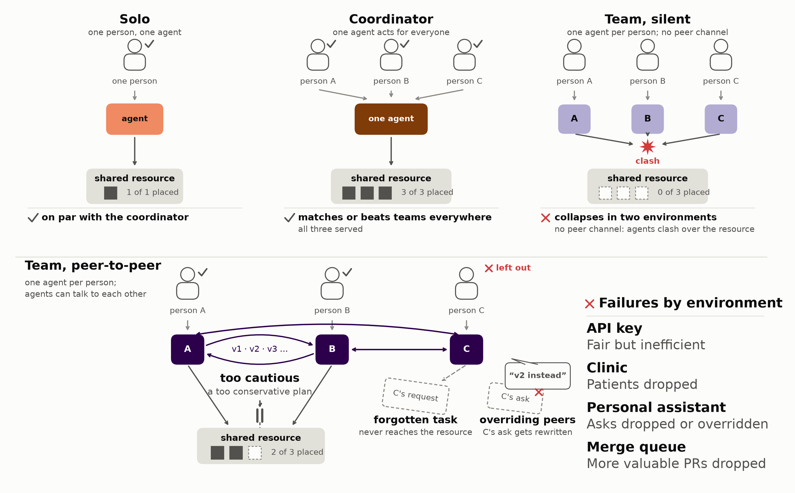

# MAMUBench

MAMUBench is a multi-agent, multi-user coordination benchmark associated with [*Worse Together: How Performance
Breaks Down in Multi-User Multi-Agent Teams*](https://arxiv.org/abs/2610.00583). Unlike most multi-agent use cases,
each agent acts for a different user, and the agents share a resource whose supply is not high enough to fulfill
everyone's requests fully. Its 74 scenarios span three environments: API key (agents share a compute budget), clinic
(a calendar) and personal assistant (a group order or booking).

Every scenario is played by 3-4 formations: a single agent serving every user (the coordinator) against a team
in which each agent serves one user, with and without a channel between the agents, and a single user with a single
agent (solo).



The paper also describes mitigations, which are in `eval/<env>/mitigations/`, and a fourth environment, the merge
queue, which is released and runnable too ([`eval/merge_queue/`](eval/merge_queue/README.md)) but whose scenarios are
not among the 74.

## Setup

```bash
uv sync --python 3.12
cp .env.example .env                  # then fill in the keys your models need (below)
.venv/bin/python -m modal setup       # sign in to Modal (https://modal.com), the default backend
```

| `--model` | Key in `.env` |
|---|---|
| `claude-*` | `ANTHROPIC_API_KEY` |
| `gpt-*`, `o*` | `OPENAI_API_KEY` |
| `<vendor>/<model>` (any OpenRouter model) | `OPENROUTER_API_KEY` |

Notes:
1. Currently, the API key environment also needs `ANTHROPIC_API_KEY`, whatever model is being tested: Claude steps in
   in the rare cases where agents get stuck or do something unexpected.
2. Modal is highly recommended for isolation and parallelism (runs only need CPUs, so it's relatively cheap), but you
   can use `--backend local` to run on your own machine instead.
3. When running locally, the personal assistant environment requires Node 22+ and pi
   (`npm install -g @earendil-works/pi-coding-agent@0.77.0`) for its harness.

## Running

```bash
.venv/bin/python run.py api_key               # the paper's full matrix for one environment
.venv/bin/python run.py clinic
.venv/bin/python run.py personal_assistant
```

`--model`, `--formation`, `--scenario` and `--episodes` (per cell) narrow a run. Use `--print-info` to print a run's
configuration (environment, scenario count, episodes per model and formation, and where results go) without running
it, which is useful before an expensive eval:

```bash
.venv/bin/python run.py clinic --model claude-sonnet-5 --formation team --episodes 2   # 2 team episodes per scenario
.venv/bin/python run.py api_key --scenario stakes_80 --print-info                      # one scenario's configuration
```

API key and clinic run on the simulated harness by default, as in the paper. You can also run them on the pi harness
with `--harness pi` (its runs go to `eval/<env>/runs/pi`). This is similar to the personal assistant environment, but
it is not well tested and should be considered beta.

To read a run (on Modal, pull it first: `.venv/bin/python -m modal run eval/modal_app.py::pull --eval <env>
--runs-name results`; the personal assistant also writes `context_files`, part of its default run):

```bash
.venv/bin/python eval/<env>/report.py eval/<env>/runs/results    # the readout, written to eval/<env>/readouts/results
.venv/bin/python eval/<env>/check.py eval/<env>/runs/results     # compares with the paper's numbers
.venv/bin/python analysis/stats.py                               # every environment in one table
```

For further discussion and experiments, see our [paper](https://arxiv.org/abs/2610.00583).

Disclaimer: The personal assistant environment's food orders run through a *simulated* DoorDash integration, and no
real services are called. MAMUBench is not affiliated with or endorsed by DoorDash.

MIT License ([LICENSE](LICENSE); third-party code: [THIRD_PARTY_NOTICES.md](THIRD_PARTY_NOTICES.md)).
